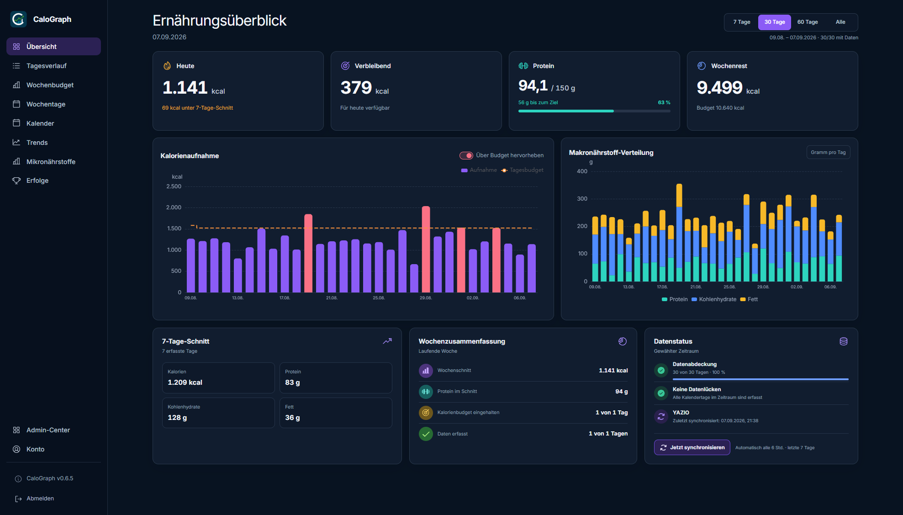

<p align="center">
  
</p>

<p align="center">
  <strong>Self-hosted, multi-user nutrition analytics for Apple Health and YAZIO</strong>
</p>

<p align="center">
  <a href="#quick-start-localprivate">Quick start</a> |
  <a href="docs/apple-health-setup.md">Apple Health</a> |
  <a href="docs/yazio-sync.md">YAZIO sync</a> |
  <a href="docs/production.md">Production</a> |
  <a href="#operations-and-development">Documentation</a>
</p>

---

CaloGraph is a self-hosted, multi-user nutrition dashboard for Apple Health and
YAZIO data. It combines daily nutrition, versioned budgets and targets, optional
activity-calorie credits, trends, achievements, and data-quality views without
moral judgment or external telemetry.

> [!WARNING]
> **CaloGraph is under active development.** Version `0.x` releases may contain
> incomplete features, breaking changes, or migrations that require attention.
> Features and behavior may change between releases. Keep tested backups and
> review the changelog before updating.

<p align="center">
  
</p>

## Highlights

- **Multi-user by design:** each account has isolated imports, samples, targets,
  achievements, tokens and personal integrations.
- **Versioned nutrition analytics:** daily calories and macros, historically
  effective budgets and targets, trends, calendar and data-quality views.
- **Activity-aware budgets:** optional imported activity-calorie credits can
  increase the effective daily calorie budget without turning CaloGraph into a
  workout tracker.
- **Portable data:** ZIP export/import and separate CSV archive export are
  available; CSV import is not currently supported.
- **Managed account lifecycle:** the first administrator can be created through
  the browser, then further accounts are invitation-only with password, MFA and
  passkey options.

## Future development

CaloGraph is actively evolving. Planned areas of development include:

- **AI-assisted nutrition analysis:** use structured nutrition, meal and food
  data for deeper, opt-in analysis beyond charts and daily aggregates.
- **Expanded trends and micronutrient analytics:** rebuild the trends and
  micronutrient views around richer long-term analysis, period-over-period
  comparisons, data coverage and clearer macro- and micronutrient insights,
  with optional reference-value context where appropriate.
- **Richer Apple Health ingestion:** explore additional nutrition and meal-level
  data where the available Apple Health export paths provide reliable metadata.

These are planned development directions, not compatibility guarantees or
release commitments. External provider APIs and available data may change over
time.

## Multi-user by design

Run one instance for multiple accounts. Health samples, imports, target history,
achievements, import tokens and each personal YAZIO connection are scoped to
their owner. Administrators manage account metadata, lifecycle and one-time
invitations; the administration UI does not expose another account’s nutrition
values. The deployment operator controls the database, secrets and backups.
See [User management](docs/user-management.md).

## Data sources

### Recommended: Health Auto Export

For ongoing iPhone transfer, Health Auto Export sends the HealthKit categories
you authorize to your CaloGraph endpoint over HTTPS with an account-scoped
import token. iOS may delay background exports; CaloGraph cannot bypass those
platform restrictions. See [Apple Health setup](docs/apple-health-setup.md) and
the [import API](docs/import-api.md).

### Historical Apple Health

Upload Apple Health’s `export.xml` or ZIP in CaloGraph. Apple Health often lacks
reliable food, recipe and meal names, so CaloGraph analyzes daily nutrient totals
rather than inventing meal detail.

### Experimental YAZIO integration

Direct/scheduled sync uses only the pinned `yazio-sdk==0.4.0` integration with
an undocumented provider interface and may stop after provider changes; Health
Auto Export remains the recommended default. Scheduled credentials are encrypted
and user-scoped. Enabling direct YAZIO sync deliberately communicates with YAZIO.
Compatible historical `days.json` and `nutrients.json` files can be imported
independently of direct sync; `yazio-exporter` is only an optional external
producer of those files, not a runtime dependency. CaloGraph is independent of
and not endorsed by YAZIO. See [YAZIO sync](docs/yazio-sync.md) and
[third-party notices](THIRD_PARTY_NOTICES.md).

## Quick start (local/private)

Prerequisites: Docker Compose and Git. This example is for a loopback/private
development instance, not an Internet-facing deployment.

```sh
git clone https://github.com/tarantila/CaloGraph.git
cd CaloGraph
cp .env.example .env
./scripts/init-secrets.sh
# Review .env; keep CALOGRAPH_PUBLIC_URL on the address you use

docker compose -f docker-compose.yml -f docker-compose.dev.yml up -d --build
docker compose ps
```

Open <http://localhost:8180>. On an empty instance, the sign-in page offers
one-time creation of the first administrator. The browser setup creates only
the account; sign in to continue through the normal onboarding.

There is a CLI alternative available when needed:

```sh
docker compose exec backend python -m app.cli create-user
```

After initialization, further accounts are created only through
**Administration → Einladungen**. See [User management](docs/user-management.md)
for lifecycle and recovery operations.

## Production deployment

`.env.example` is for local/private development and must not be exposed through
an Internet-facing proxy. Start production from
[`.env.production.example`](.env.production.example), use the final HTTPS
origin, keep `INITIAL_ADMIN_SETUP_ENABLED=false` unless a controlled first-run
window is explicitly intended, and follow the [production checklist](docs/production.md).
The [reverse-proxy guide](docs/reverse-proxy.md) covers TLS and upload limits.

## Privacy and security

CaloGraph ships no telemetry, analytics or CDN dependencies. Imported data is
stored in the operator’s deployment. Direct YAZIO sync is an explicit outbound
integration. Sessions, CSRF checks, trusted hosts/origins, password policy,
rate limits and security events are part of the application boundary; review
[SECURITY.md](SECURITY.md) and the [security monitoring guide](docs/security-monitoring.md).

Account exports contain only the authenticated user’s data and exclude
credentials, token hashes, sessions and other security material. The portable
format is documented in [Data export](docs/data-export.md). It is not a database
dump.

## Architecture and data provenance

Adapters normalize source records for analytics while retaining source type,
source name and source identifier with per-user deduplication. The same day
imported from Apple Health and direct YAZIO is not deduplicated across source
boundaries; choose one path for overlapping days. See
[architecture](docs/architecture.md), [data model](docs/data-model.md) and
[analytics definitions](docs/analytics-definitions.md).

```text
Apple Health / Health Auto Export / YAZIO
                 │
                 ▼
       account-scoped import adapters
                 │  source provenance + deduplication
                 ▼
       versioned targets and analytics API
                 │
                 ▼
          account-scoped dashboard
```

## Operations and development

- [Architecture](docs/architecture.md)
- [User management](docs/user-management.md)
- [Production operations](docs/production.md)
- [Reverse proxy and TLS](docs/reverse-proxy.md)
- [Backup and restore](docs/backup-restore.md)
- [Security monitoring](docs/security-monitoring.md)
- [Threat model](docs/threat-model.md)
- [Supply-chain and image retention](docs/supply-chain.md)
- [Data export and portable import](docs/data-export.md)
- [Import API](docs/import-api.md)
- [YAZIO synchronization](docs/yazio-sync.md)

Backend development uses Python 3.14 and the project lockfile; frontend
development uses the package lockfile. The repository CI workflow contains the
supported checks. Do not use development defaults for a public deployment.

### Analysis demo (disposable developer databases only)

Use `seed-analysis-demo` **only against a confirmed disposable development or
test database** (`ENVIRONMENT=development` or `ENVIRONMENT=test`). Never point
these commands at a real health database or a production instance. Create a
separate real account first; the dedicated non-admin
`calograph-analysis-demo` account cannot be the first user. From the backend
directory:

```sh
cd backend
uv run python -m app.cli seed-analysis-demo
uv run python -m app.cli seed-analysis-demo --include-current-day-supplement
uv run python -m app.cli seed-analysis-demo --include-follow-up-meals
uv run python -m app.cli remove-analysis-demo
```

The seed command prompts privately for a password only when creating the
account. After successful seeding, log in as `calograph-analysis-demo` with
that privately entered password. Rerunning does not reset the password or
replace the original 90-day seed anchor. The optional
`--include-current-day-supplement` flag adds today's synthetic
`Europe/Berlin` meals as one strictly audited supplement when the date lies
outside the original seed window. Repeating it for the same date is
idempotent; it does not move the anchor or create supplements for later dates.
`--include-follow-up-meals` additionally adds one strictly audited pudding
after dinner today and three meals tomorrow. It leaves the existing supplement
unchanged, preserves both days' projection history, and is idempotent for the
same date; it does not create supplements for later dates.
Removal refuses an account containing changes or references it cannot prove
belong to the seed and does not delete any other user's data. Repeating
removal when the account is absent is a no-op;
Changes made by the former legacy demo seeder to unmarked target histories are
**not automatically reversible**. Restore those from a known-good disposable
database snapshot if needed; the current removal command is not a legacy cleanup.

#### Persistent Analysis review runtime

From the repository root:

```sh
make analysis-review-up
```

This starts the isolated review site at `http://localhost:8289` and stores its
`calograph_analysis_v2_test` database in the named Docker volume
`calograph-analysis-v2-review-postgres-data`. On the first start, the existing
secret generator creates private review-only secrets, and the existing CLI
privately prompts for the synthetic bootstrap and demo account passwords.
Later starts migrate to the current Alembic head and skip seeding when the
demo account already exists, preserving its data and preferences.

```sh
make analysis-review-down
```

This removes only the review containers and networks; the database volume and
review secrets remain. No production `.env` or `:8288` runtime is used.

## Limitations

- This is 0.x software; review migrations and maintain independent backups.
- There is no native iOS app and no server-side Apple Health/HealthKit iCloud
  retrieval. An authorized iPhone exporter is required for ongoing data, and
  iOS can delay background delivery.
- CaloGraph is not medical software and does not provide medical diagnosis or
  treatment.
- There is no CSV importer yet; CSV is currently an export format only.
- Overlapping Apple Health and YAZIO days are intentionally not cross-source
  deduplicated; provenance remains distinct.
- The undocumented YAZIO interface is experimental and may break.

## Contributing

Before proposing changes, read the relevant architecture, security and data
export documentation. Keep account isolation, source provenance and the
non-medical boundary intact.

## License and provenance

CaloGraph source is available under
[PolyForm Noncommercial 1.0.0](LICENSE). This is not an OSI-approved open-source
license. Third-party components retain their own licenses; see
[THIRD_PARTY_NOTICES.md](THIRD_PARTY_NOTICES.md).

## Brand assets

The wordmark and application logo in `frontend/public/branding/` are project
brand assets.
